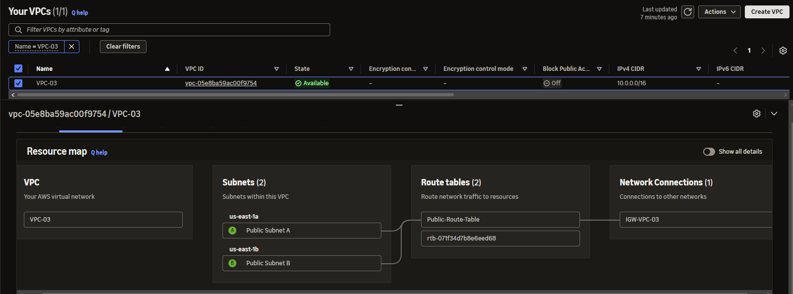
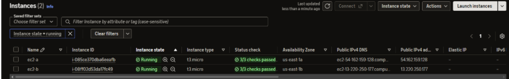
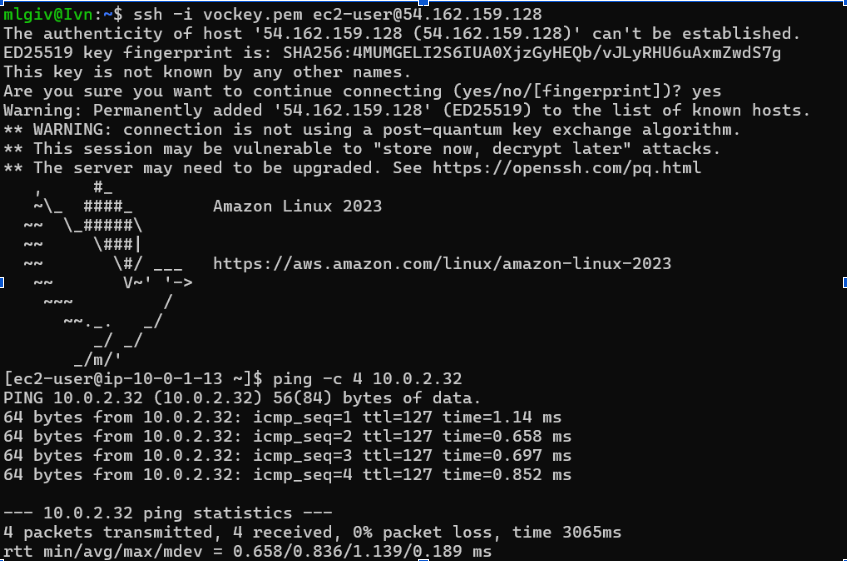

# Pràctica 2.2: Infraestructura a AWS amb Terraform

En aquesta pràctica hem automatitzat el desplegament de la infraestructura bàsica a AWS usant Terraform utilitzant la regió us-east-1

## Components de la pràctica

- **Instàncies EC2:** Dos màquines `t3.micro` amb Amazon Linux `ec2-a` i `ec2-b`, desplegades cadascuna en una subxarxa diferent fent servir la clau `vockey`.
- **Grup de seguretat:** 
  - Trànsit lliure per a soritdes (`0.0.0.0/0`).
  - Accés per SSH des de qualsevol lloc (`0.0.0.0/0`).
  - Trànsit de tipus ICMP permès només des des de connexions internes de la VPC (`10.0.0.0/16`).
- **VPC (`VPC-03`):** Xarxa privada configurada amb el bloc CIDR `10.0.0.0/16`.
- **Internet Gateway i Taula de rutes:** Connexió a Internet configurada (`0.0.0.0/0` cap a l'IGW) i associada a les dues subxarxes.
- **Subxarxes públiques:** 
  - `Public Subnet B` a la zona `us-east-1b` (`10.0.2.0/24`) amb assignació automàtica d'IP pública.
  - `Public Subnet A` a la zona `us-east-1a` (`10.0.1.0/24`) amb assignació automàtica d'IP pública.

## Captures

### VPC i Mapa de Recursos



### Instàncies EC2



### Prova de connectivitat (SSH i Ping)




## Execució

```bash
    Terraform init
    Terraform validate
    Terraform plan
    Terraform apply -auto-approve
```

### Y per a destruir/desconfigurar tot hem de fer

```bash
    Terraform destroy -auto-approve
```


